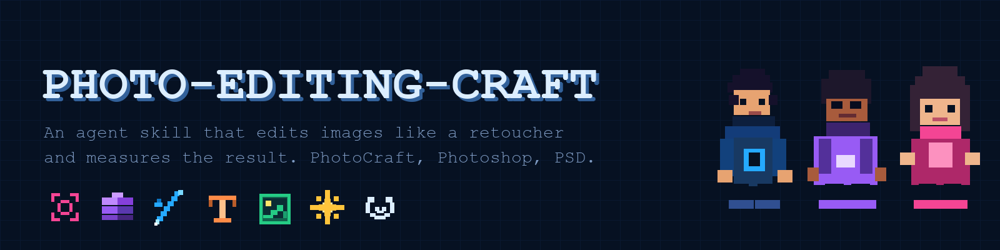
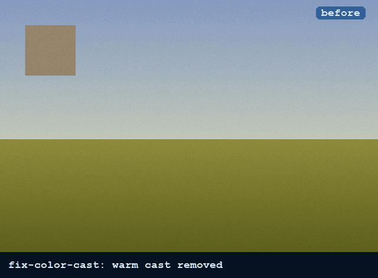
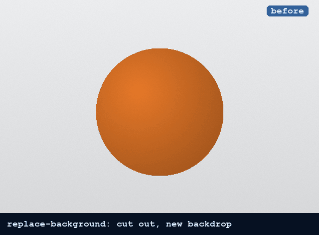
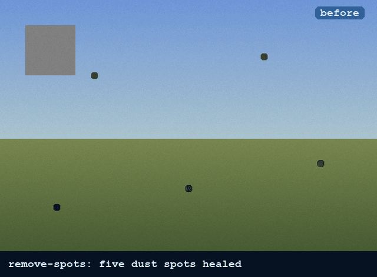
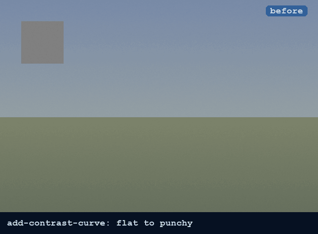

<p align="center"></p>

# photo-editing-craft

An agent skill for Claude Code and other `SKILL.md` agents that edits photos and graphics the way a
retoucher would, then measures the result before it says "done".

**Works with [PhotoCraft](https://github.com/storytold/photocraft) (open source), Adobe Photoshop
and layered PSD files.** Color correction, retouching, cutouts and masks, compositing, type on
images, web and social export, CMYK print prep.

<p align="center">
  
  
  
  
</p>

Every GIF is a real recipe run from this repo on its test image, recorded by
`scripts/make_demo_media.py`.

## Why

An agent connected to an image editor can run any command. Left alone it still boosts
saturation before fixing tone, sharpens before resizing and calls a cutout finished without
looking at the edge. This skill gives it the order of operations and the tool choices a
retoucher makes, and a way to check the output with numbers:

```
gray card channel spread   44.0  ->  0.2
contrast (luma std)        15.2  ->  27.5
size / mode                1080 x 1350, sRGB JPEG
```

## Quick start

```sh
git clone https://github.com/aipiratesMunich/photo-editing-craft ~/.claude/skills/photo-editing-craft
```

Then ask your agent in plain words:

> Remove the color cast from product.jpg, cut the product out, put it on #1e3c5a and export a 1080x1350 post. Keep a layered PSD.

For PhotoCraft, build it (`cargo build --release` in a checkout of
[storytold/photocraft](https://github.com/storytold/photocraft)) and put `photocraft-cli` on
`PATH` or set `PHOTOCRAFT_CLI`. To give the agent its MCP tools:

```sh
claude mcp add photocraft -- photocraft-cli mcp --automation-read-root ~/Pictures --automation-write-root ~/Pictures
```

For Adobe Photoshop the skill gives menu paths and shortcuts (Mac and Windows) for 76 tasks and
pairs with a Photoshop MCP such as [adb-mcp](https://github.com/mikechambers/adb-mcp). The
scripts use photocraft-cli in both cases, so measured checks need a PhotoCraft build.

## PSD files

`run_recipe.py` and `verify.py` open and save `.psd` with layers, masks, type and fill layers
intact, so you can chain recipes on a client's PSD and hand back a PSD:

```sh
scripts/run_recipe.py recipes/replace-background.json --in shot.psd --out step1.psd
scripts/run_recipe.py recipes/title-with-shadow.json  --in step1.psd --out final.psd
```

PhotoCraft's PSD support covers common files well. Open the result in Photoshop once before you
deliver it to someone who will.

## What is inside

```
SKILL.md            checklist, order of operations, where to look
craft/              decision guides: intake, workflow order, color and tone, retouching,
                    selection and masking, compositing, typography, web output, print output
backends/           photocraft.md (MCP, CLI, footguns), photoshop.md (menu map, automation),
                    photocraft-commands.tsv (876 commands with parameter docs)
recipes/            14 tested recipes with variables and pixel expectations
scripts/            run_recipe.py, verify.py, test_all.py, demo and fixture builders
tests/fixtures/     generated test images (no third-party photos)
```

## Recipes

| Recipe | Does | In Photoshop |
|---|---|---|
| fix-color-cast | gray point on a neutral | Curves, Set Gray Point |
| add-contrast-curve | S-curve on an adjustment layer | Curves adjustment layer |
| natural-saturation | vibrance boost that spares skin | Vibrance adjustment layer |
| black-and-white | per-color gray mapping | Black & White adjustment layer |
| vignette | soft darkened edges | feathered selection, fill layer, Multiply |
| remove-spots | heals dust on an empty layer | Spot Healing Brush, Sample All Layers |
| cutout-to-mask | subject to layer mask | Select Subject, Select and Mask |
| replace-background | cutout on a new color | Select Subject, mask, Solid Color fill |
| title-with-shadow | live headline with drop shadow | Type tool, Drop Shadow |
| image-inside-text | photo clipped into letters | Create Clipping Mask |
| watermark | semi-transparent corner text | Type tool, layer opacity |
| social-export-4x5 | crop, 1080 x 1350, sharpen, sRGB | Crop 4:5, Image Size, Convert to Profile |
| resize-for-web | downsize, sharpen after, sRGB | Image Size, Unsharp Mask, Export As |
| print-prep-cmyk | 300 ppi, CMYK conversion | Image Size, Convert to Profile |

Recipes refer to layers as `$background`, `$last` or a name instead of fixed ids, so they run on
any document. `scripts/test_all.py` runs all 14 on their fixtures. Each expectation was checked
to fail on the untouched image, so a pass means the edit happened.

## How the agent checks its work

```sh
scripts/verify.py out.pcraft --preview look.png \
  --expect '{"width":1080,"height":1350,"regions":[{"region":[40,40,80,80],"max_channel_spread":6}]}'
```

`verify.py` prints size, mode, ppi, the layer tree, mean color, contrast, clipping and chroma,
per region if asked, and exits non-zero when an expectation fails. The skill tells the agent to
look at the preview and report the numbers.

## Limits

- PhotoCraft has no generative or ML features (no Generative Fill, Sky Replacement, Neural
  Filters). Its Select Subject is classical and works best on clear contrast.
- PhotoCraft writes PDF as raster only; layout work with live text belongs in a layout app.
- Confirm any Photoshop shortcut you rely on in Edit > Keyboard Shortcuts; they can differ by
  version and keyboard layout.

## Contributing

New recipes are the most useful contribution: a JSON recipe, a fixture (generate it in
`scripts/make_fixtures.py`), an `expect` block, and proof that the expectation fails on the
untouched fixture. Run `scripts/test_all.py` before opening a pull request.

## License

MIT, see [LICENSE](LICENSE). `backends/photocraft-commands.tsv` is generated from PhotoCraft
(MIT OR Apache-2.0). The pixel artwork in `docs/media/` is part of this project and MIT licensed.
Adobe and Photoshop are trademarks of Adobe Inc.; this project is not affiliated with or
endorsed by Adobe.
